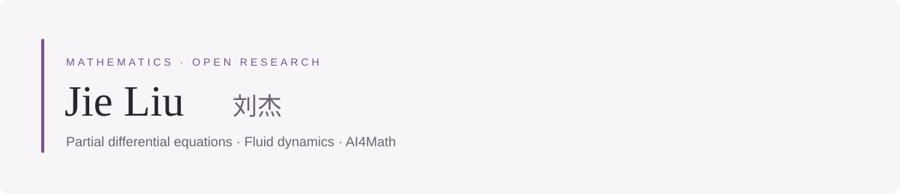

  <a href="https://jieliu-maths.github.io">Academic website</a> &nbsp; · &nbsp;
  <a href="https://jieliu-maths.github.io/publications/">Publications</a> &nbsp; · &nbsp;
  <a href="https://jieliu-maths.github.io/ai-research-workflow/">AI4Math project & demo</a>

I am a **Postdoctoral Associate in Mathematics at New York University Abu Dhabi**.
My research concerns singularity formation and long-time dynamics in fluid and dispersive equations.

### Mathematics

I study nonlinear partial differential equations, with interests in fluid dynamics,
self-similar blow-up, nonlinear waves, and the interaction of coherent structures with radiation.
See my [research overview](https://jieliu-maths.github.io/research/) and
[publications and public preprints](https://jieliu-maths.github.io/publications/).

### Open research tools

**[AI Research Workflow](https://github.com/jieliu-maths/AI-Research-Workflow)**  
An AI4Math-first workflow for keeping proof obligations, evidence, independent review,
and human-approved results visible across research sessions.

[Explore the interactive teaching demo →](https://jieliu-maths.github.io/ai-research-workflow/#workflow-demo)  
[English documentation](https://github.com/jieliu-maths/AI-Research-Workflow#readme) ·
[中文说明](https://github.com/jieliu-maths/AI-Research-Workflow/blob/main/README.zh-CN.md) ·
[Experimental AI4S profile](https://github.com/jieliu-maths/AI-Research-Workflow/tree/main/profiles/ai4s)

---

My **[academic website](https://jieliu-maths.github.io)** presents my research, papers, talks, and teaching.
This GitHub profile collects the public tools and source repositories behind that work.
